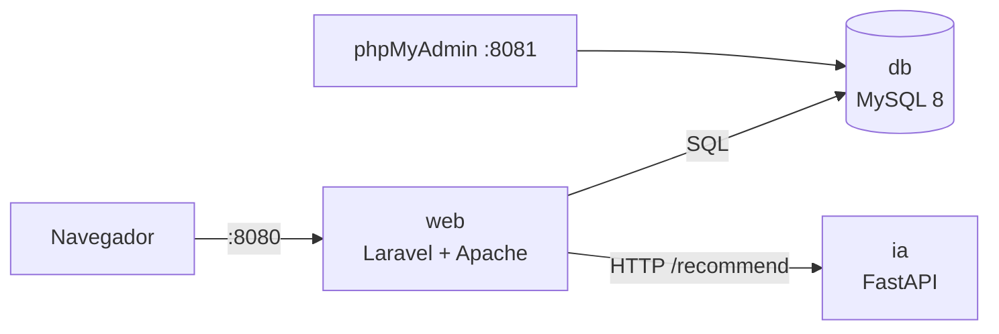

# TechStore: Docker Compose y CI/CD

## Arquitectura



| Servicio | Tecnología | Puerto en tu equipo | Función |
|---|---|---|---|
| `web` | PHP 8.3 + Apache + Laravel | 8080 | Tienda, carrito, pedidos y administración |
| `ia` | Python 3.11 + FastAPI | 8002 | Asistente virtual y recomendaciones |
| `db` | MySQL 8.0 | (interno) | Base de datos `techstore` |
| `phpmyadmin` | phpMyAdmin 5 | 8081 | Administrar la base de datos |

Los servicios se comunican por la red interna de Compose usando el nombre del servicio
(`db`, `ia`). Los datos de MySQL y las imágenes de productos viven en volúmenes de Docker,
por lo que no se pierden al reiniciar.

## Uso

```bash
# Primera vez
cp .env.docker.example .env.docker      # y completar APP_KEY
docker compose up -d --build
docker compose exec web php artisan db:seed --force    # datos de ejemplo (solo la primera vez)

# Día a día
docker compose up -d       # encender
docker compose down        # apagar (conserva los datos)
docker compose logs -f web # ver errores de la tienda
docker compose down -v     # apagar y BORRAR los datos
```

## Pipeline CI (GitHub Actions, `.github/workflows/ci.yml`)

Se ejecuta en cada push a `main`, `develop` y ramas `feature/**`, y en cada pull request.

| Trabajo | Qué hace |
|---|---|
| **Pruebas Laravel** | Instala dependencias y ejecuta las pruebas de PHPUnit (`php artisan test`) |
| **Pruebas microservicio IA** | Ejecuta las pruebas unitarias del motor de recomendación |
| **Build y pruebas de integración** | Construye las imágenes, levanta web + IA + MySQL con Docker Compose, carga datos y ejecuta `scripts/smoke-test.sh` |

El tercer trabajo solo corre si los dos primeros pasan. Si el build o cualquier prueba falla,
el pipeline queda en rojo y se muestran los registros de los contenedores.

## Pruebas

- **Unitarias (IA):** `ia-service/tests`
- **Funcionales (Laravel):** `tests/Feature` (autenticación, catálogo, carrito, pedidos, administración y asistente)
- **Integración:** `scripts/smoke-test.sh` (web + base de datos + microservicio IA)
